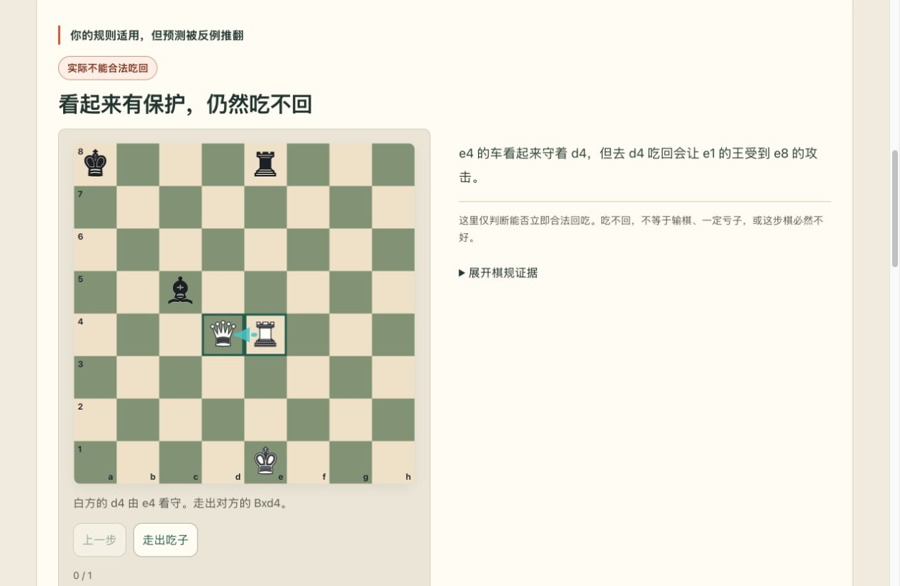
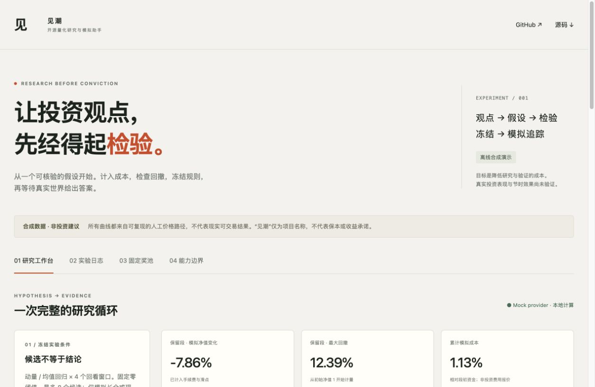
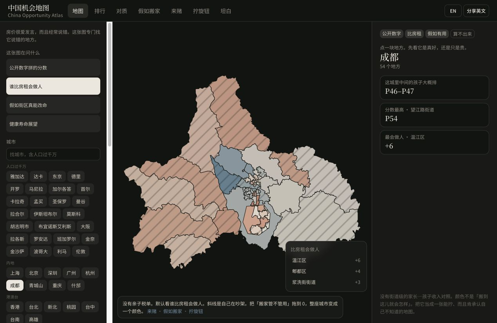

# 鲜唯佳

电子信息工程背景，和 AI 一起把问题做成可以试用的工具。AI 参与研究、界面、代码实现与测试。

## 先试这三个

### 弈外 · YiWai Chess

国际象棋练习与复盘，通过变化、对照和反例理解一步棋。

[开始下棋](https://knight-room.weijiaxian.chatgpt.site/) · [试试「破招」反例练习](https://knight-room.weijiaxian.chatgpt.site/refute.html)

### 见潮 · Jianchao

把投资观点拆成可核验假设，检查证据、成本与风险，保留失败过程的开源研究与模拟工具。

[体验合成演示](https://strategy-lab.weijiaxian.chatgpt.site/) · [查看源码](https://github.com/Ericnotme/fanshi-research) · [公开验证记录](https://github.com/Ericnotme/fanshi-research/blob/main/docs/validation.md)

**可核验的工程记录：** [2026-10-12 公开验证记录](https://github.com/Ericnotme/fanshi-research/blob/main/docs/validation.md#local-provenance-repair-and-public-case--2026-10-12)记载 **76 项 Node 测试通过、0 项失败**；这是项目已有的公开记录，本次主页更新未重新运行这些测试。线上演示仍为较早发布版本，最新来源删减检查与公开研究示例请看源码。合成演示与工程测试不代表盈利能力已验证，真实投资表现尚未验证。

[六个公开方法 Skills](https://github.com/Ericnotme/fanshi-research/tree/main/.agents/skills)，由鲜唯佳与 AI 协作整理，包含步骤、边界与合成案例：

- [核查预测时间窗](https://github.com/Ericnotme/fanshi-research/blob/main/.agents/skills/audit-forecast-window/SKILL.md)
- [先诊断，再投入](https://github.com/Ericnotme/fanshi-research/blob/main/.agents/skills/diagnose-before-commit/SKILL.md)
- [提炼可审查的方法](https://github.com/Ericnotme/fanshi-research/blob/main/.agents/skills/distill-auditable-method/SKILL.md)
- [找到最小有用动作](https://github.com/Ericnotme/fanshi-research/blob/main/.agents/skills/find-minimum-core-action/SKILL.md)
- [保留来源原意](https://github.com/Ericnotme/fanshi-research/blob/main/.agents/skills/preserve-source-meaning/SKILL.md)
- [验证普通用户入口](https://github.com/Ericnotme/fanshi-research/blob/main/.agents/skills/verify-human-entry/SKILL.md)

### 机会地图 · Grok 版

对照公开资料编制地区评分、比较模型情景，追问一个地方的机会是否只是价格暗示的那样。

[打开地图](https://breeze-cosmic-honey-plaza.grok.me/) · [查看模型说明](https://breeze-cosmic-honey-plaza.grok.me/methodology) · [相关开源研究版（独立版本）](https://github.com/Ericnotme/china-opportunity-atlas)

地区评分和模型情景不等于个人收入预测，也不证明搬家会带来收益。

以上图片为 2026-10-12 从公开演示页面截取的真实界面；弈外使用内置示例，见潮使用合成数据。

## 其他工具与源码

- [投资尺 · Invest Ruler](https://investment-ruler.weijiaxian.chatgpt.site/#performance)：从连续月收益查看净值、回撤和风险指标。
- [知荐 · Zhijian](https://github.com/Ericnotme/zhijian)：Python 内容推荐原型，探索内容相似度、行为反馈和混合排序；源码公开。

更多工具与实验：[个人实验室](https://weijia-lab.weijiaxian.chatgpt.site/)。

## 社交媒体与联系

- 微信：`xwj1357930380`
- X：[@EricXianWeiJia](https://x.com/EricXianWeiJia)
- Instagram：[@xianweijia](https://www.instagram.com/xianweijia/)
- Threads：[@xianweijia](https://www.threads.com/@xianweijia)
